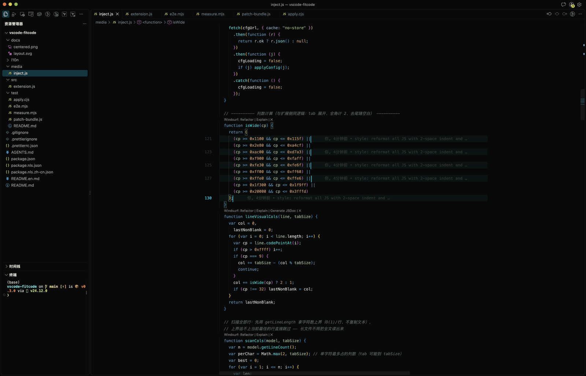
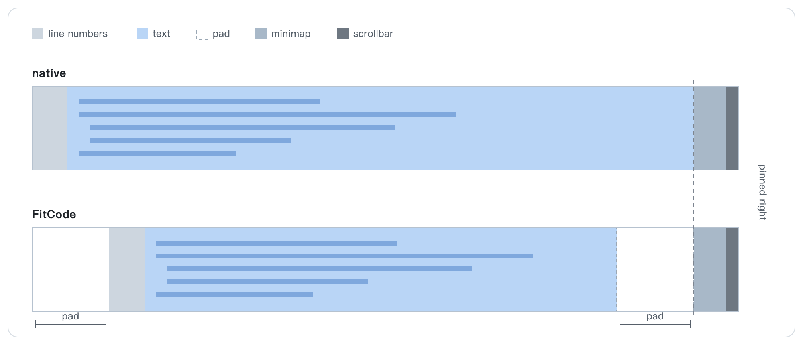

# FitCode

English | [简体中文](README.zh-CN.md) | [Website](https://feudalman.github.io/vscode-fit-code/)

**Stop twisting your neck to the left**

Makes the VS Code editor behave like JetBrains IDEs: **the text width follows the content** — narrow content gets centered, content wider than the panel fills it and scrolls horizontally. Line numbers indent together with the text, the tab bar always spans the full width, and the **scrollbar and minimap stay pinned to the editor's right edge**.

Fully adaptive, no thresholds to configure: any file is centered as long as it fits, and fills the panel the moment it does not. Width follows the content when you switch files (7 s, several files of different widths opened in one window):



> The theme in the recording is my own too: search `dark-arui` in the Marketplace, source at [Feudalman/dark-arui](https://github.com/Feudalman/dark-arui).

Centering, line numbers following the cursor and the width animation don't depend on each other, so you can keep just one of them. If you want the line numbers to follow the cursor and nothing else, set `fitcode.center` to `false` and the line-number part keeps working. All the switches are listed under Settings below.

## What it is

A VS Code extension that patches VS Code's own layout computation (opt-in via the Enable command):

- **Renderer** (`media/inject.js`): for every editor, reads its own document, computes the visual width of its longest line (tabs expanded, full-width characters counted as 2 columns, trailing whitespace ignored), derives the centering inset from "own panel width − line-number gutter − minimap − scrollbar − target width", and writes it into that editor's own `rulers` option (a transparent, invisible ruler) as a carrier.
- **Layout** (bundle patch): Monaco's `computeLayout` reads each editor's own rulers carrier and applies the inset to glyphMargin / line numbers / decorations / contentLeft (+pad) and contentWidth (−2×pad); `EditorScrollbar._setLayout` then **widens** the container that holds the text by the pad (never touching `left`), so its right edge reaches the editor's right edge.
- **Injection**: `media/inject.js` is inlined into `workbench.html`. Inline scripts require removing that file's CSP meta — the original is kept in a base64 comment and restored verbatim on disable.



**No flicker when switching files**: the renderer is event-driven (`onDidChangeModel` / content change / layout change), so the rulers are written before paint when you switch tabs. The longest-line result is cached per file uri in `localStorage` (line count + total characters + first/last line samples as a fingerprint) and reused when you reopen the file.
Width changes animate over 140 ms by default (the `ANIMATE` / `ANIM_MS` at the top of `media/inject.js`), applied only to the left/width of `.editor-scrollable`, so mouse hit-testing is unaffected.

**Line numbers only on the cursor line**: with `editor.lineNumbers` set to `on`, only the cursor line shows a number (every cursor when there are several).
The gutter keeps its width (only `opacity` changes), so the text does not jump as the cursor moves. `off` is unaffected; `relative` / `interval` keep their native behavior.

**Only the text and line numbers are centered**: the minimap and the scrollbar stay pinned to the right edge (the scrollbar is a child of the text container, which is only widened, never shifted).

**With split editors, every group computes independently** from its own width and content (rulers are a real per-editor option, so there is nothing to conflict).

## Install and use

The extension modifies two files inside the VS Code install folder (both are backed up automatically and restored with one command):

- `workbench.desktop.main.js`: 4 anchored patches
- `workbench.html`: inserts the inline injection script (and moves the CSP meta into a base64 comment)

1. Install **FitCode** from the [VS Code Marketplace](https://marketplace.visualstudio.com/items?itemName=arui.fit-code) — or run `code --install-extension arui.fit-code`
2. Reload the window, run **`FitCode: Enable`** from the Command Palette, then reload again when prompted
3. Done — narrow files are centered, wide files fill the panel

**Disable**: run **`FitCode: Disable`** → reload the window (restored verbatim from the automatic backup).
**Status**: run **`FitCode: Show status`**.
**Upgrade**: update the extension from the Marketplace, then run **`FitCode: Enable`** once — a previously applied patch is restored from the backup first, then every patch is applied again from the new version.

Working from source instead? Drop the repo into `~/.vscode/extensions/arui.fit-code-<version from package.json>/` — but uninstall the Marketplace copy first, or both activate and each one patches the install folder.

## Settings

`FitCode: Enable / Disable` controls whether the patch is in place; the settings below only matter while it is. Changes take effect in 1-2 seconds, no need to enable again or reload the window.

| Setting | Default | Effect | With centering off |
|---|---|---|---|
| `fitcode.center` | `true` | Center the text. Turn it off to go back to the native layout | — |
| `fitcode.lineNumbersOnlyAtCursor` | `true` | Show line numbers only on the cursor lines, all of them when there are several cursors | Keeps working |
| `fitcode.animate` | `true` | Animate the width when switching files or when the content changes | No effect |
| `fitcode.animateDuration` | `140` | Animation duration (ms), 0 means no animation | No effect |
| `fitcode.minTextWidth` | `640` | Minimum text width (px) | No effect |
| `fitcode.paddingRight` | `20` | Extra padding on the right of the text (px) | No effect |
| `fitcode.cacheSize` | `300` | How many widths to cache per file | No effect |

Three configurations worth copying:

Only the line numbers, no centering:

```json
{ "fitcode.center": false }
```

Centering with the native line numbers:

```json
{ "fitcode.lineNumbersOnlyAtCursor": false }
```

Centering without the animation:

```json
{ "fitcode.animate": false }
```

How it works: the renderer has no access to the settings API, so the extension writes the settings above into `out/vs/workbench/fitcode.config.json` (created on enable, deleted on disable); the renderer polls it every 2 seconds and when the window gains focus. If you edit that json and only write some of the keys, the missing ones keep their current value.

## Known limits

- Files with `editor.wordWrap` enabled follow the same rule: whether the text is centered depends only on how wide the content is. When it does not fit, the panel is filled and the lines fold at the panel width (no horizontal scrolling); when it does fit, the text is centered and the fold width shrinks with the inset. Only `wordWrap: "wordWrapColumn"` (a column width you fixed yourself) is left alone.
- Editor panels narrower than 400 px are not centered (a window shrunk to a small square looks like "not working at all")
- A VS Code upgrade can break the patch anchors — the extension detects that and refuses to patch (it never damages the install); wait for support for the new version
- After the first enable, VS Code may warn that the installation "appears to be corrupt" — the expected result of its checksum validation; just dismiss it

## Development

- `src/extension.js`: extension logic — patching and restoring `workbench.html` / the bundle, the enable/disable commands
- `media/inject.js`: the renderer script (column counting + writing the rulers carrier)
- `package.nls*.json` + `l10n/`: strings. English is the source (and the fallback); every other language is one file per kind
- `docs/`: the website (`index.html` + `site.css` + `site.js`, served by GitHub Pages) and the images used by the READMEs (`switch.gif` is a screen recording, `layout.svg` is hand-drawn, `layout.png` is rendered from it because the Marketplace rejects SVG in READMEs)
- `test/`: CDP-driven E2E (`e2e.mjs`), offline patch body generation (`patch-bundle.js`), live geometry diagnostics (`measure.mjs`); usage and the assertion table are in `test/README.md` (Chinese)

### How the patch works (`patchBundle` in `src/extension.js`)

Four patches against `workbench.desktop.main.js` (each guarded by a uniqueness assertion; a mismatch aborts instead of guessing):

1. `_createConfiguration`: exposes every `CodeEditor` instance on `window.__ftEditors`
2. `updateOptions`: fallback registration (config changes and similar paths)
3. head of `computeLayout`: the gate (wordWrap ≠ `wordWrapColumn` and width ≥ 400) + reading the inset `__ftP` from rulers; in the return value glyphMargin / line numbers / decorations / contentLeft += `__ftP`, contentWidth −= 2×`__ftP`, and `viewportColumn` / `wrappingColumn` are recomputed from the narrowed width so wrapped text folds inside the centered column
4. `EditorScrollbar._setLayout`: the scrollbar container's **left never moves** (`left = contentLeft`; the text position *is* this container's left, moving it would move the text too), and its **width gains the pad** (`width = contentWidth + pad (+minimapWidth)`), so the container's right edge reaches the editor's right edge and the vertical scrollbar / overview ruler inside it end up on the right

> Why patch 4 exists: the scrollbar is a child of the `contentLeft + contentWidth` container, and patch 3 shrinks `contentWidth` by `2×pad`, so the scrollbar "follows the text towards the center". Patch 4 only widens the container by `pad`, leaving the text position alone.

The original file is backed up to `workbench.desktop.main.js.fitcode.bak` before patching and restored verbatim on disable.
Upgrading: update the extension from the Marketplace and run `FitCode: Enable` once — traces of an older patch are restored from the backup first and the new patches are applied on top (a missing backup is reported explicitly; the install is never damaged).
